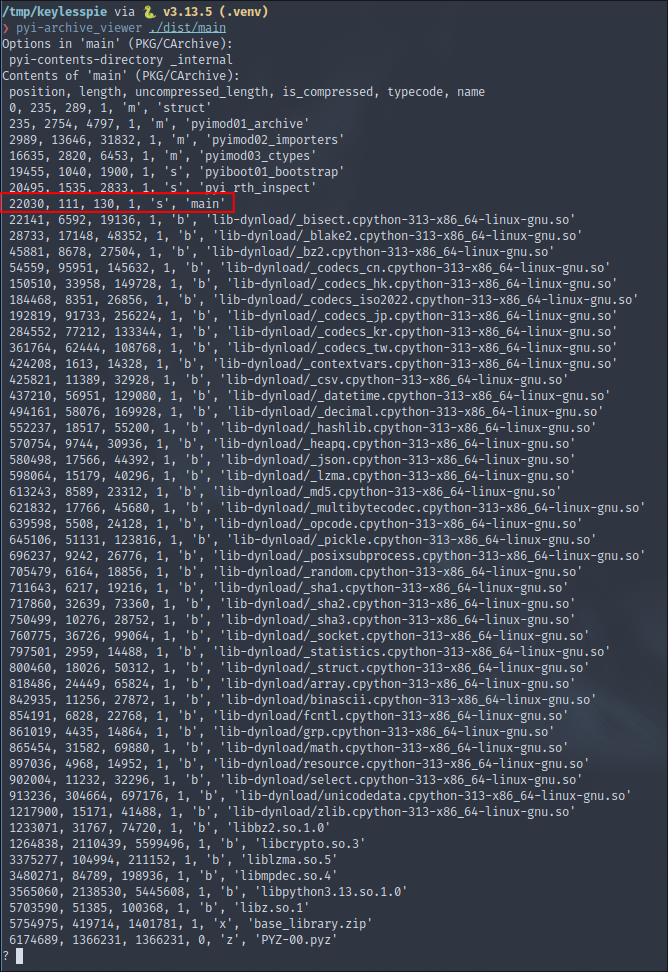

This is going to be a very small article about a trick I made for a challenge named "KeylessPie" at the **MindBreak 2025** CTF.

The players were given a Python ransomware packaged has an ELF binary with PyInstaller, but I patched the file so they can't reverse it so easily.

## What is PyInstaller

**PyInstaller** is a tool that packages Python applications into standalone binaries that are executable without having to install the Python interpreter and all it dependencies.

It works by analyzing a Python script to discover all the required modules and libraries, then bundling them together with a Python interpreter into a **single executable**.

It is often used by threat actors to pack their **Python malwares**.

### How to use it

Here's a simple example on Linux:
```bash
$ echo 'print("Hello Gelven")' > main.py
$ pyinstaller -F main.py 	# -F for one-file mode
$ file dist/main
dist/main: ELF 64-bit LSB pie executable, x86-64, version 1 (SYSV), dynamically linked, interpreter /lib64/ld-linux-x86-64.so.2, BuildID[sha1]=3f0f69ad7a43302a7199060b7179f548013e4e39, for GNU/Linux 4.4.0, stripped
$ ./dist/main
Hello Gelven
```

## Unpacking it

In one-file mode, the resulting executable contains a bootstrap program written in C that extracts the bundled components into memory or a temporary folder at runtime, then starts the Python application as if it were running normally from source.

It would be too long to reverse the C bootstrap, so there are two simple ways.

### Use PyInstaller tooling

When installing PyInstaller, it comes with some tools, one of which lets us navigate into the binary's archive : `pyi-archive_viewer`.

 
We can see that it can list some components in the binary, and we spot the name of our original script `main`.

Let's extract it:
```
? X main	# Command to extract a file
Output filename? main.bin
?		# Command to quit
```

### pyinstxtractor

TODO

## Devil’s trick

The tools I just previously mentionned use the same tactic to unpack the binary, which is based on the magic marker (also called cookie) : `MEI\014\013\012\013\016`.

TODO

## Conclusion

How much can we corrupt the cookie ?

TODO

## Credits
- TODO

## Footnotes

[^capa]: The FLARE team's open-source tool to identify capabilities in executable files.
